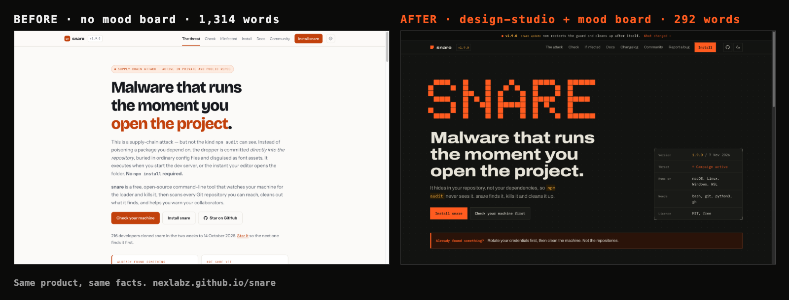

# Evidence: does it work?

Everything below was measured on 2026-11-14 against the live site, nexlabz.github.io/snare.

## Before and after



| | Before (no mood board) | After (design-studio + mood board) |
|---|---|---|
| Home page words | 1,314 | 292 (−78%) |
| Structure | one long page | 9 pages: a short home, long reads with a reading-time rail, a real changelog and a bug-report form |
| Look | cream background, rounded cards | graphite, signal orange, dot-matrix type, taken from a Pinterest board |

"Before" is the same site at commit `f4747ea` of nexlabz/snare. Claude built it without this skill. "After" is commit `7a712f8`.

## The stop-ship check (`scripts/verify.mjs`)

All 9 pages were checked at 375 px and 1440 px, 18 loads in total:

- every page returned HTTP 200;
- no page scrolls sideways at either width;
- no console errors, except the comments widget on /community, whose GitHub app isn't installed yet (snare issue #62).

Screenshots of every page are in [`examples/`](examples/).

## Reproduce it

```bash
cd plugins/design-studio/skills/design-studio/scripts
node verify.mjs https://nexlabz.github.io/snare / /attack.html /check.html /docs.html /changelog.html /security.html
```
