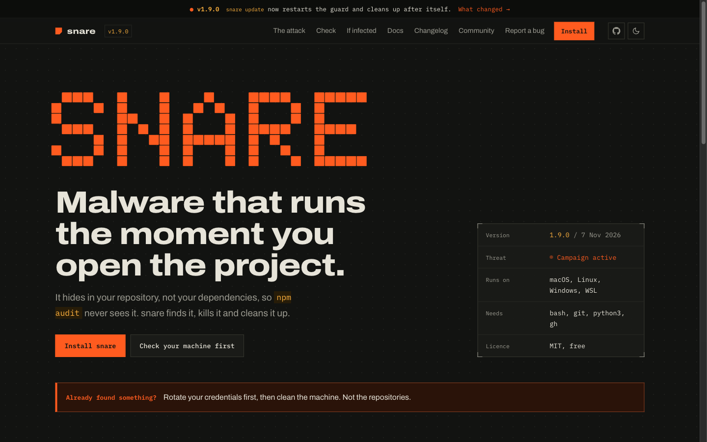
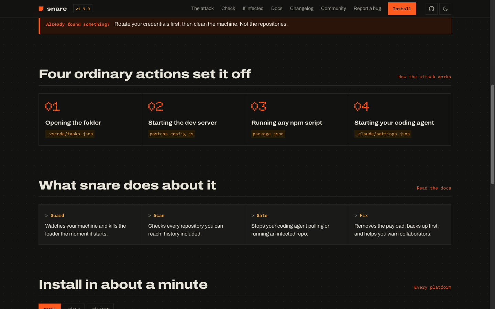
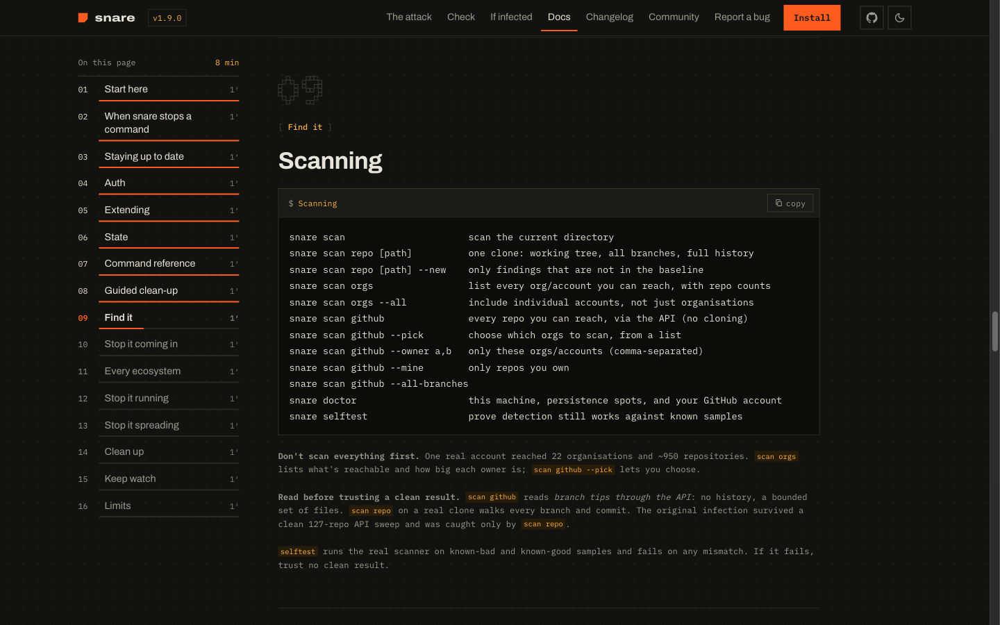
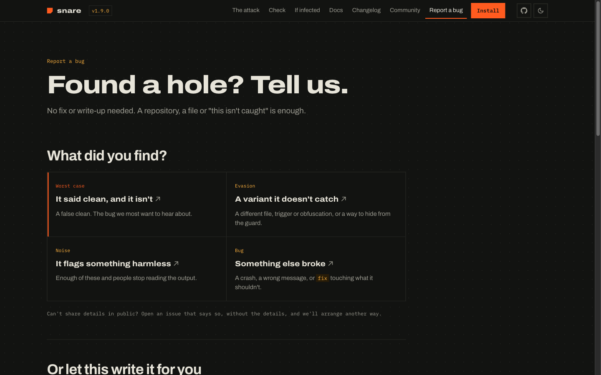
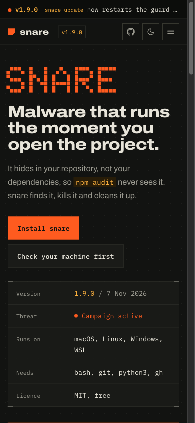

# design-studio

A skill for Claude that designs websites the way a studio would: it starts from **your mood board**, not from its defaults.



## Why

Ask an AI for a website and you get the same site everyone gets: a cream background with a serif font, or black with one neon accent, and content chopped into identical cards. design-studio stops at the start and asks for your mood board. Then it makes every decision from that board and from what your product actually is.

## What it does

1. **Reads your mood board.** Paste a Pinterest, Are.na or Figma link, or drop in screenshots. It pulls out the palette, type, framing, density and motifs, and writes them down before it designs anything. No board? It tells you the result will lean generic and suggests where to collect references.
2. **Gives the product a personality.** A maps product should feel like a map: a pannable canvas, a crosshair cursor, coordinates. A kids' product uses very little text. A security tool reads like a field manual.
3. **Cuts the copy.** People don't read. Every page gets a word budget.
4. **Picks the right shape for each page.** A short home page, long reads with a reading time and progress rail, and separate pages for things like changelogs and bug reports.
5. **Builds and checks itself.** Design tokens, light and dark themes, accessibility, SEO, then screenshots at phone and desktop sizes before calling anything done.

## Example: snare

The site for [snare](https://nexlabz.github.io/snare/), an open-source malware scanner, came from one Pinterest board: industrial spec sheets, graphite, signal orange, amber terminal text and dot-matrix numbers.

| | |
|---|---|
|  |  |
|  |  |

## Install

**Claude Code**

```
/plugin marketplace add AviOfLagos/design-studio
/plugin install design-studio@design-studio
```

Or copy `plugins/design-studio/skills/design-studio` into `~/.claude/skills/`.

**Claude.ai and the Claude app**

Download `design-studio.zip` from the [latest release](https://github.com/AviOfLagos/design-studio/releases/latest), then upload it under Settings → Capabilities → Skills.

## Use

Just ask for design work: "build me a landing page for X", "this looks generic, fix it", "here's my Pinterest board". It asks for a mood board first if you haven't shared one.

A browser tool (Claude in Chrome, Playwright, or the built-in browser in the Claude app) makes the mood-board step much better. Without one, share screenshots of the board.

## Credits

By [David Olatunji](https://avi.nexprove.com). It merges my award-tier-ui skill with Anthropic's [frontend-design](https://github.com/anthropics/claude-plugins-official) skill (Apache-2.0); see `NOTICE.md`. MIT licence for everything else.
